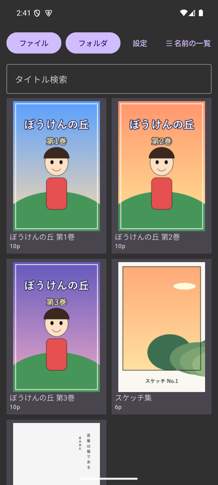
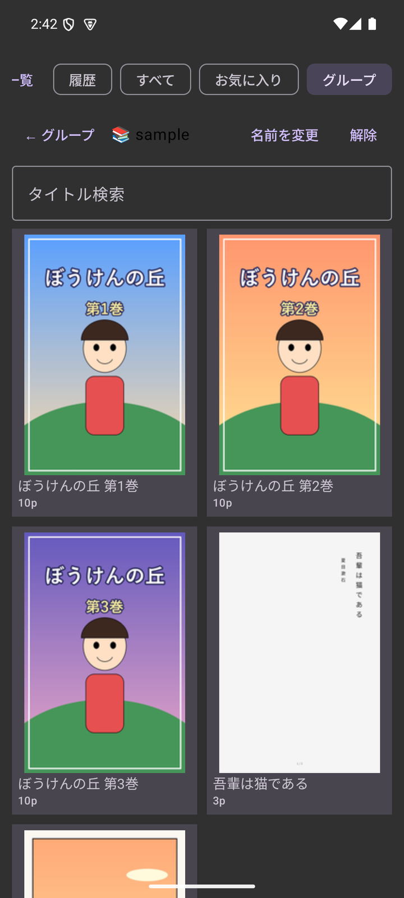
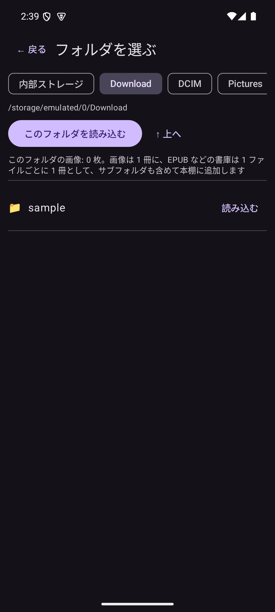
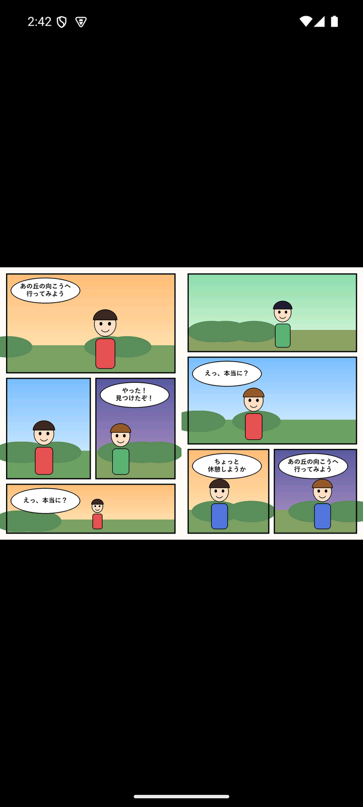
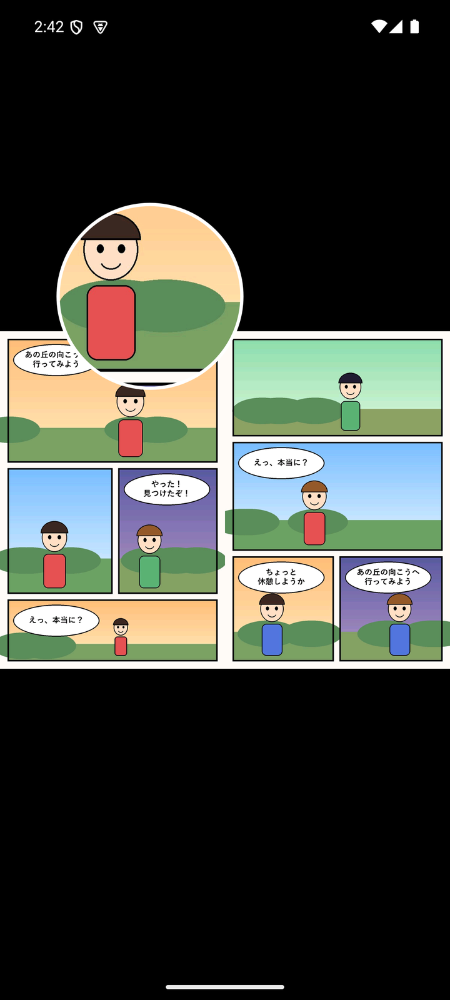
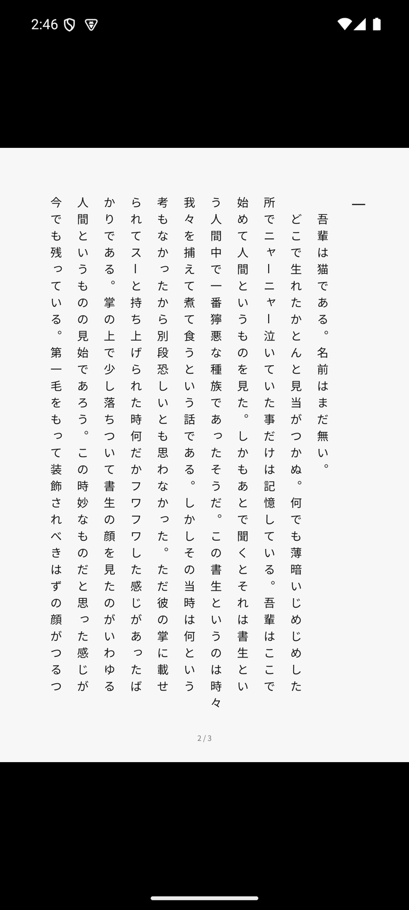
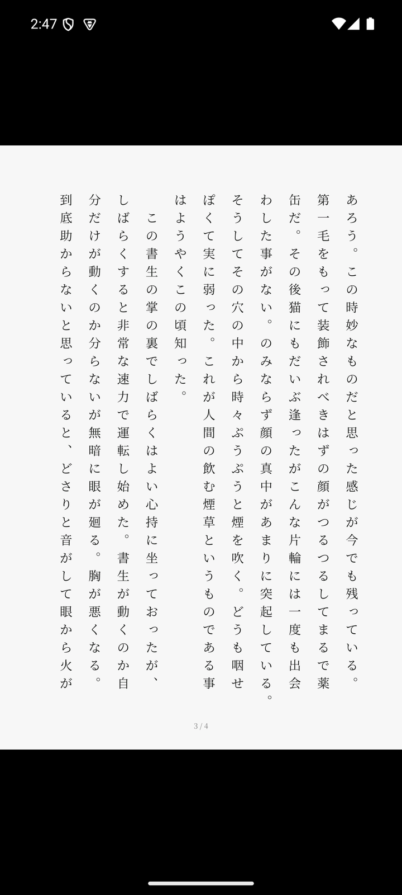
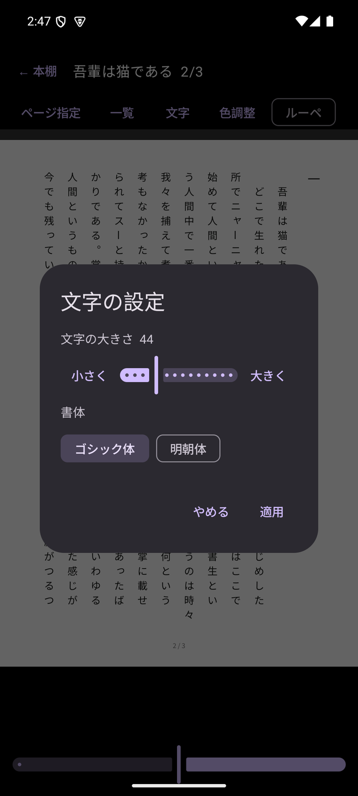
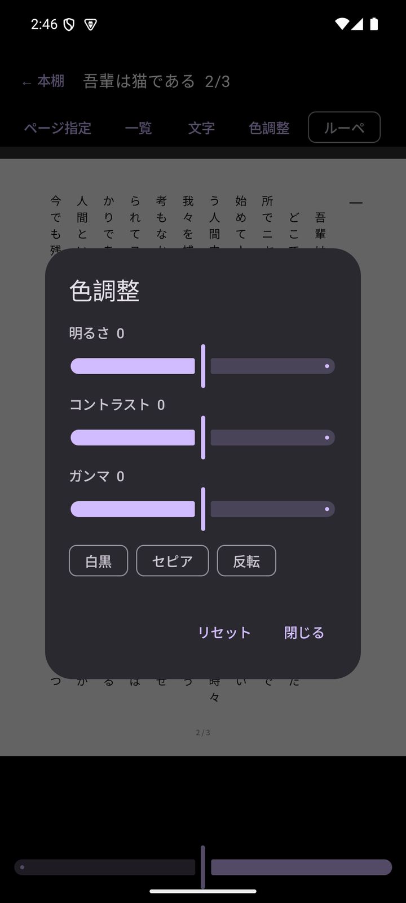

<p align="center"></p>

# RustHighBookViewer

[English](README.md) | **日本語**

Rust で作った、コミック・画像・小説のビューアです。ZIP/CBZ・7z・RAR・EPUB・画像フォルダを、右綴じの見開きや縦書きで読めます。Android と Windows で動きます。

> **状況: 開発中（v0.1.x・プレリリース）。** Android はエミュレータ（Android 15）での確認までで、実機での動作は未確認です。

## 特長

- **いろいろな形式を開けます**: ZIP / CBZ、7z、RAR（4.x / 5.x、暗号化なし）、EPUB、画像フォルダ。
- **読みやすい表示**: 単ページ・見開き・自動見開き・縦スクロール。右綴じ／左綴じ、表紙だけ単独表示、横長ページは単独表示。幅・高さ・全体・全画面のフィット。
- **拡大とルーペ**: ピンチやダブルタップで拡大してパン。指でなぞった所を 2 倍に拡大するルーペ（Android）。
- **EPUB（コミックも小説も）**: 1 ページが 1 枚の画像の EPUB（コミック・写真集）を読む順に開きます。画像の無い文章の EPUB（Web 小説など）は、端末の日本語フォントで **縦書き** のページに描いて表示します。文字の大きさ（28〜80）・行間（120〜240%）・ゴシック体／明朝体を、閲覧メニューと設定画面から変えられます。
- **本棚**: 履歴・お気に入り・タイトル検索。サムネイル表示と、ファイル・フォルダ名の一覧表示を切り替えられます。閉じても読んでいた位置を保存して、続きから開けます。本を閉じたときは、本棚を開く前の状態（タブ・検索・スクロール位置）に戻ります。
- **グループ化**: 複数の本をグループにまとめられます。複数の本が入ったフォルダを読み込むと、フォルダ名のグループが自動で作られます。
- **フォルダの一括読み込み**: 各フォルダ直下の画像を 1 冊に、EPUB・ZIP・7z・RAR は 1 ファイルを 1 冊にして、サブフォルダも含めて本棚へ登録します（Android は並列で登録）。
- **便利な操作（Android）**: ページ一覧のサムネイル、ページ指定、しおり、色調整（明るさ・コントラスト・ガンマ・白黒・セピア・反転）、オートめくり、音量キーでのページ送り、左右フリックでのページめくり。
- **5 か国語の画面（Android）**: 日本語・English・中文（简体）・한국어・Español。設定で切り替えられます（端末の言語に合わせることも可能）。
- **安全への配慮**: 展開するサイズとファイル数に上限があり、空き容量が少ないときは途中で止めます。書庫の中の `../` のようなパスは無効にします。
- **2 回目から速い**: ページの大きさを覚えておくので、次に開くときの読み込みが速くなります。

## スクリーンショット

サンプルの画像は、このリポジトリのために作った絵と、青空文庫にある夏目漱石『吾輩は猫である』（著作権切れ）の冒頭です。

<table><tr><td align="center"><br><sub>本棚（サムネイル）</sub></td><td align="center"><br><sub>本棚（名前の一覧）</sub></td><td align="center"><br><sub>グループ</sub></td><td align="center"><br><sub>フォルダ選択</sub></td></tr></table>
<table><tr><td align="center"><br><sub>見開き（右綴じ）</sub></td><td align="center"><br><sub>閲覧メニュー</sub></td><td align="center"><br><sub>ルーペ</sub></td><td align="center"><br><sub>全画面フィット</sub></td></tr></table>
<table><tr><td align="center"><br><sub>文章 EPUB（縦書き）</sub></td><td align="center"><br><sub>明朝体・大きめの文字</sub></td><td align="center"><br><sub>文字の設定</sub></td><td align="center"><br><sub>色調整</sub></td></tr></table>

## 対応環境

| 環境 | 内容 |
|---|---|
| Android | Android 8.0（API 26）以上。Kotlin / Jetpack Compose の画面と、Rust のコアを UniFFI でつないでいます。 |
| Windows | デスクトップ版（egui）。ZIP/CBZ・7z・RAR・EPUB・フォルダを開けます。ファイルやフォルダを exe にドラッグ＆ドロップします。 |
| コマンドライン | `pv-cli`: フォルダ／書庫の画像を PNG に書き出します。 |

## 入手方法

[GitHub Releases](https://github.com/taotaro1104-commits/RustHighBookViewer/releases) から、APK（Android）と exe（Windows）をダウンロードできます。SHA-256 は `SHA256SUMS.txt` に載せています。

- APK は自分で作った鍵で署名しています。端末で「提供元不明のアプリ」の許可が必要です。
- exe は署名しておらず、Windows の SmartScreen が警告を出すことがあります。
- Android 11 以降で、Download や内部ストレージの最上位のフォルダを選ぶには、「すべてのファイルへのアクセス」を許可します（アプリ内のフォルダ選択を使います）。許可しない場合は、標準のフォルダ選択（SAF）で動きます。この権限は Google Play の審査向きではないため、APK の直接配布向けです。

## 使い方

1. **開く**: Android は本棚の「ファイル」か「フォルダ」から選びます。Windows は exe にファイルやフォルダをドラッグ＆ドロップします。
2. **読む**: 画面の左右をタップ（または左右にフリック）してページを送ります。中央の列（上・中・下）をタップするとメニューが出て、表示モードや綴じ方向、フィット、文字の設定などを変えられます。長押しでルーペに入ります。
3. **続きから読む**: 閉じると読んでいた位置を保存します。本棚から選べば、続きから開きます。

## まだ確かめていないこと・できないこと

- Android の実機での動作（確認はエミュレータのみ）
- Windows 版の画面の見た目と操作（起動して動き続けることまで確認）
- パスワード付きの書庫と、複数ファイルに分割された RAR（非対応）
- 縦書きの EPUB 以外の組版（横書きの切り替え、縦中横、ルビの表示は未対応）
- 画面の言語切り替えは Android 版のみ（Windows 版は日本語）。英語・中国語・韓国語・スペイン語の翻訳は、ネイティブの確認を受けていません。

## ソースからビルドする

Rust（stable）が必要です。

```sh
# テスト（ワークスペース全体）
cargo test --workspace

# Windows デスクトップ版・コマンドライン版
cargo build --release -p desktop -p pv-cli

# Android（要: Android SDK / NDK、cargo-ndk、Rust の Android ターゲット）
./build-android.sh release            # .so（3 ABI）と Kotlin バインディングを生成
cd apps/android && ./gradlew assembleRelease
```

署名用の鍵は `apps/android/keystore.properties`（Git 管理外）で指定します。

### 構成

| クレート／ディレクトリ | 役割 |
|---|---|
| `pv-container` | 書庫・フォルダの抽象化（ZIP / 7z / RAR / EPUB / フォルダ、文章 EPUB の組版） |
| `pv-decode` | 画像のデコード |
| `pv-process` | 画像処理（フィルタ） |
| `pv-layout` | 見開きの割り付け |
| `pv-render` | フィット・ズームの計算 |
| `pv-core` | 本のセッション、設定、キャッシュ、入力の割り当て |
| `pv-library` | 本棚の保存（SQLite）: 履歴・しおり・グループ |
| `pv-ffi` | UniFFI による Kotlin への公開 |
| `apps/desktop` | Windows デスクトップ版（egui） |
| `apps/pv-cli` | コマンドライン版 |
| `apps/android` | Android アプリ（Kotlin / Compose） |

## ライセンス

[MIT License](LICENSE)。RAR の展開には UnRAR を使用しています。
