<p align="center"></p>

# RustHighBookViewer

**English** | [日本語](README.ja.md)

A comic, image and novel viewer written in Rust. It reads ZIP/CBZ, 7z, RAR, EPUB and folders of images, with right-to-left two-page spreads and vertical-writing text. It runs on Android and Windows.

> **Status: under development (v0.1.x, pre-release).** On Android it has only been checked in an Android 15 emulator; it has not been tested on a real device yet.

## Features

- **Many formats**: ZIP / CBZ, 7z, RAR (4.x / 5.x, not encrypted), EPUB, and folders of images.
- **Comfortable reading**: single page, two pages, automatic spread, and vertical scrolling. Right or left binding, a cover shown on its own, wide pages shown alone, and fit to width / height / whole page / fullscreen.
- **Zoom and magnifier**: pinch or double-tap to zoom and pan; a 2x magnifier that follows your finger (Android).
- **EPUB, comics and novels**: image-based EPUBs (comics, photo books) open in reading order. Text-only EPUBs such as web novels are drawn page by page as **vertical writing** with a Japanese font from the device. You can change the text size (28–80), the line spacing (120–240%), the typeface (Gothic or Mincho/serif) and the text and background colors (white, ivory, sepia, black and more) from the reader menu and the settings screen.
- **Shelf**: history, favorites and title search, with a thumbnail view or a plain list of file and folder names. Your reading position is saved, and closing a book takes you back to the shelf exactly as it was (tab, search, scroll position).
- **Groups**: put several books into a group. Importing a folder that contains several books creates a group named after the folder automatically.
- **Bulk folder import**: the images directly inside a folder become one book, and each EPUB / ZIP / 7z / RAR file becomes its own book, subfolders included, all added to the shelf (registered in parallel on Android).
- **Handy controls (Android)**: page grid, go to page, bookmarks, color adjustment (brightness, contrast, gamma, grayscale, sepia, invert), auto page turning, page turning with the volume keys, and left/right flicks.
- **Five display languages (Android)**: 日本語, English, 中文（简体）, 한국어 and Español, selectable in the settings (or follow the device language).
- **Safety**: limits on the unpacked size and the number of files, extraction stops when free space runs low, and paths such as `../` inside an archive are rejected.
- **Faster the second time**: page sizes are remembered, so books open faster next time.

## Screenshots

The sample images are artwork made for this repository and the opening of *I Am a Cat* by Natsume Soseki (public domain, from Aozora Bunko).

<table><tr><td align="center">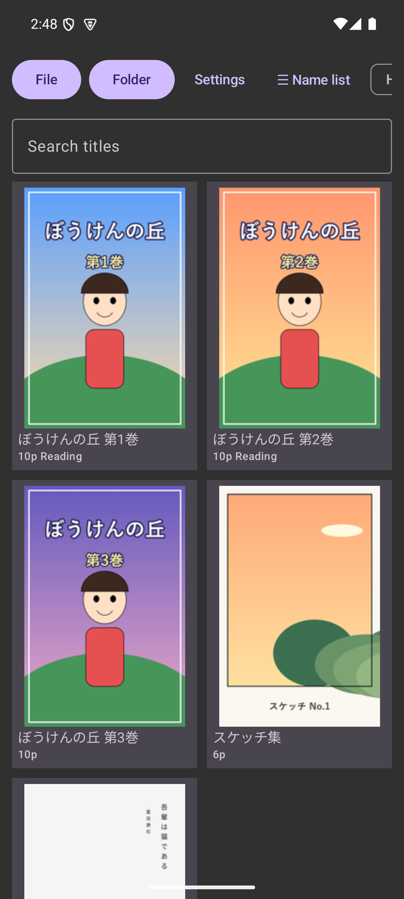<br><sub>Shelf (thumbnails, English UI)</sub></td><td align="center">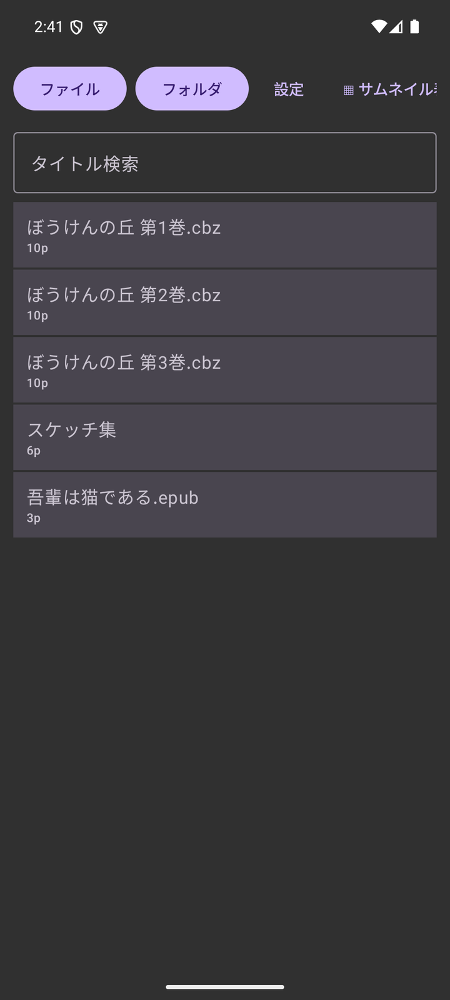<br><sub>Shelf (name list)</sub></td><td align="center">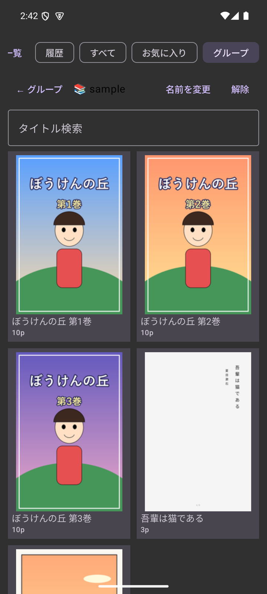<br><sub>Group</sub></td><td align="center">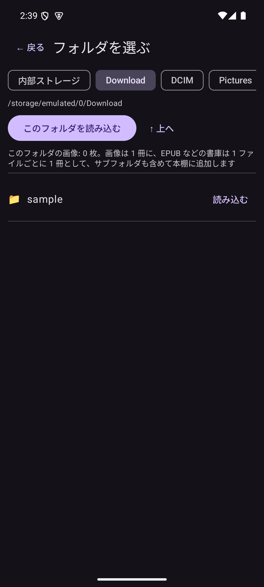<br><sub>Folder browser</sub></td></tr></table>
<table><tr><td align="center">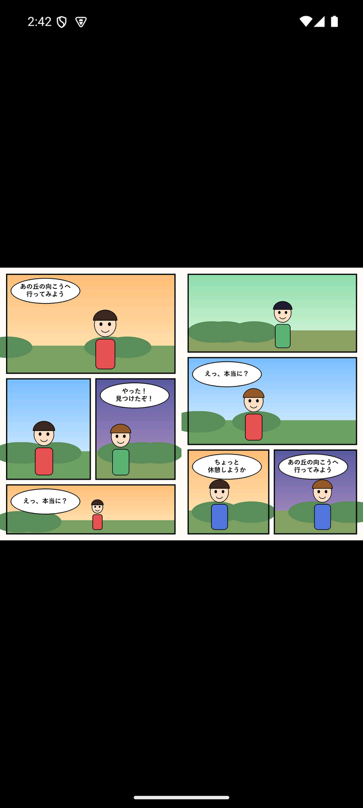<br><sub>Two pages (right binding)</sub></td><td align="center">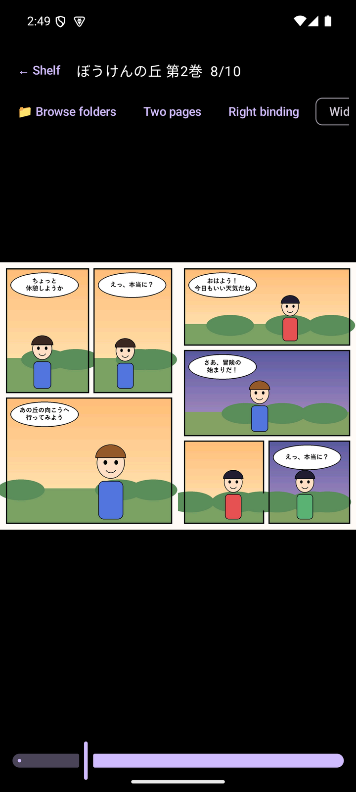<br><sub>Reader menu (English UI)</sub></td><td align="center">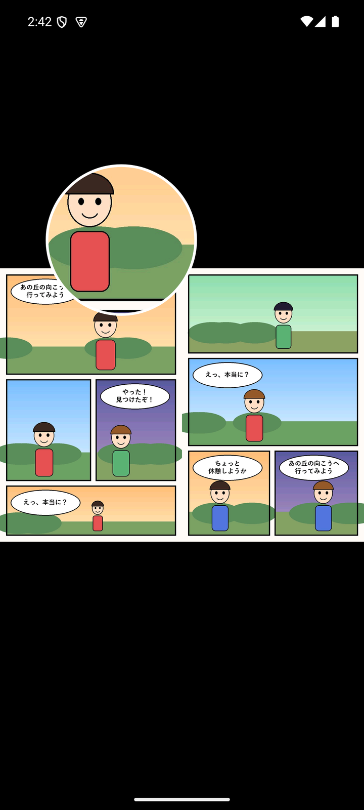<br><sub>Magnifier</sub></td><td align="center">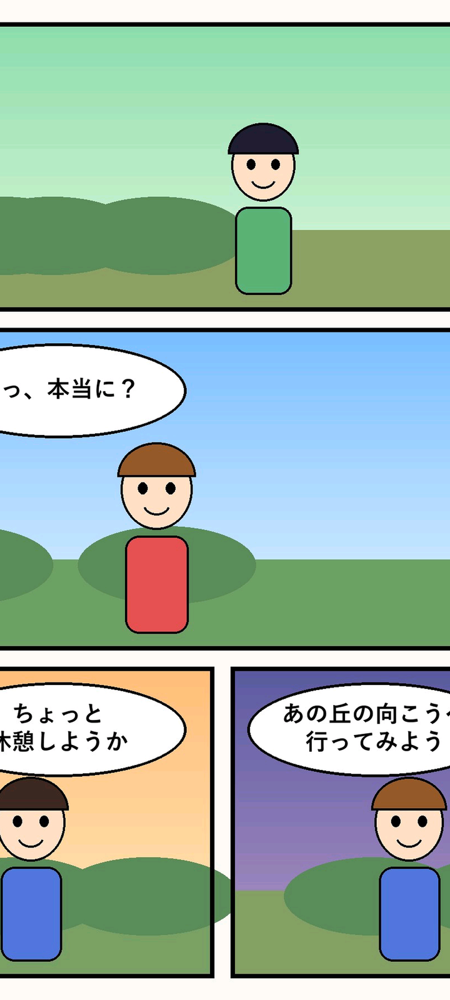<br><sub>Fullscreen fit</sub></td></tr></table>
<table><tr><td align="center">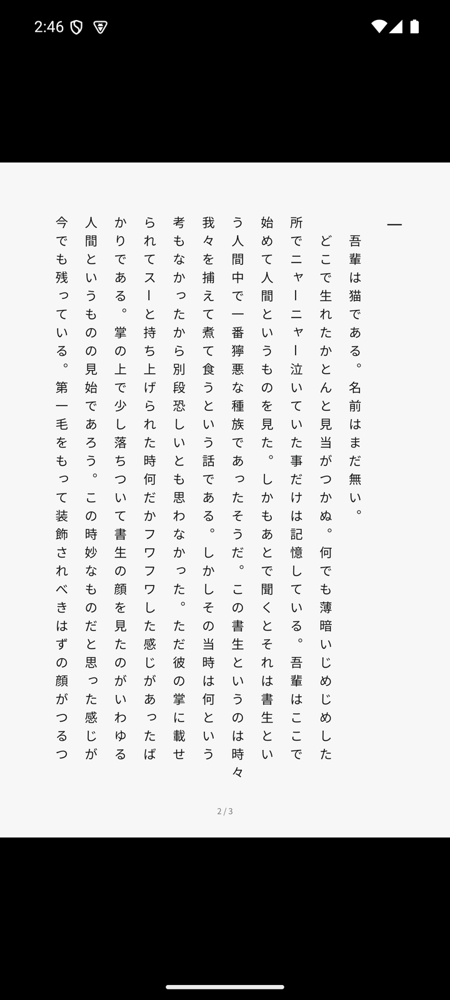<br><sub>Text EPUB (vertical writing)</sub></td><td align="center">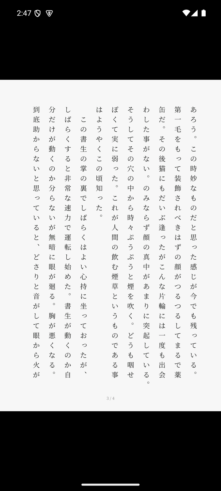<br><sub>Mincho, larger text</sub></td><td align="center">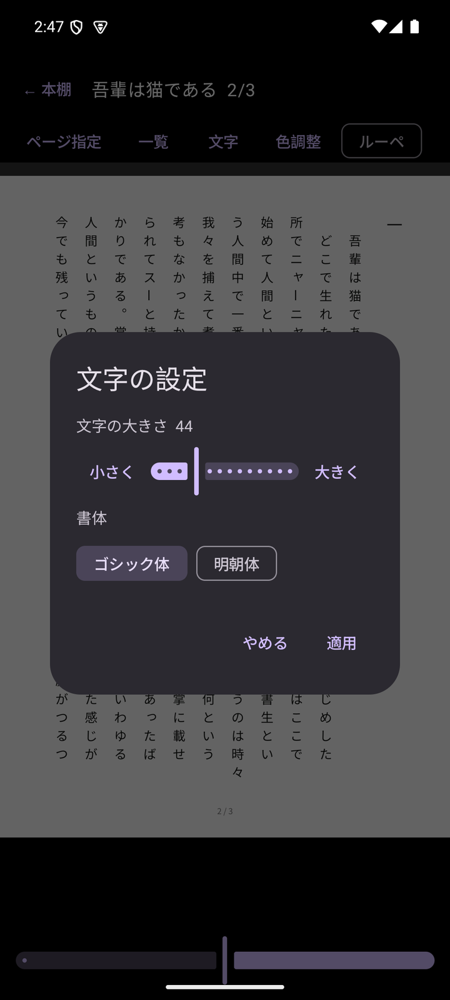<br><sub>Text settings</sub></td><td align="center">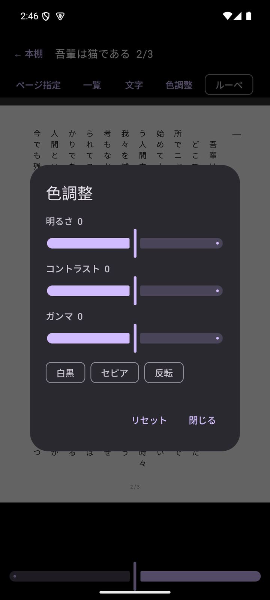<br><sub>Color adjustment</sub></td></tr></table>

## Platforms

| Platform | Notes |
|---|---|
| Android | Android 8.0 (API 26) or later. A Kotlin / Jetpack Compose UI on top of the Rust core through UniFFI. |
| Windows | Desktop version (egui). Opens ZIP/CBZ, 7z, RAR, EPUB and folders; drag and drop a file or folder onto the exe. |
| Command line | `pv-cli`: writes the images of a folder or archive out as PNG files. |

## Download

Get the APK (Android) and the exe (Windows) from [GitHub Releases](https://github.com/taotaro1104-commits/RustHighBookViewer/releases). SHA-256 checksums are in `SHA256SUMS.txt`.

- The APK is signed with a self-made key, so your device will ask you to allow apps from unknown sources.
- The exe is not code-signed, so Windows SmartScreen may show a warning.
- On Android 11 and later, choosing folders such as Download or the top level of internal storage requires the "All files access" permission (the in-app folder browser is used). Without it, the app falls back to the standard folder picker (SAF). This permission is not suitable for Google Play review, so the app is meant for direct distribution of the APK.

## How to use

1. **Open**: on Android, choose "File" or "Folder" on the shelf. On Windows, drag and drop a file or folder onto the exe.
2. **Read**: tap the left or right side of the screen (or flick left / right) to turn pages. Tap the center column (top, middle or bottom) for a menu where you can change the view mode, binding direction, fit, text settings and more. Long-press to enter the magnifier.
3. **Continue**: your position is saved when you close a book. Pick it from the shelf to continue.

## Not verified yet / not supported

- Android on a real device (only checked in an emulator)
- The look and handling of the Windows version (only checked that it starts and keeps running)
- Password-protected archives and RAR archives split into several files (not supported)
- Typesetting beyond vertical-writing EPUB (switching to horizontal writing, tate-chu-yoko and ruby display are not supported)
- Switching the display language is available only in the Android version (the Windows version is Japanese only). The English, Chinese, Korean and Spanish translations have not been reviewed by native speakers.

## Building from source

You need Rust (stable).

```sh
# tests (the whole workspace)
cargo test --workspace

# Windows desktop and command-line versions
cargo build --release -p desktop -p pv-cli

# Android (requires the Android SDK / NDK, cargo-ndk and the Rust Android targets)
./build-android.sh release            # builds the .so files (3 ABIs) and the Kotlin bindings
cd apps/android && ./gradlew assembleRelease
```

The signing key is configured in `apps/android/keystore.properties` (not tracked by Git).

### Layout

| Crate / directory | Role |
|---|---|
| `pv-container` | Abstraction over archives and folders (ZIP / 7z / RAR / EPUB / folders) and the typesetting of text EPUBs |
| `pv-decode` | Image decoding |
| `pv-process` | Image processing (filters) |
| `pv-layout` | Spread layout |
| `pv-render` | Fit and zoom calculations |
| `pv-core` | Book sessions, settings, caches and input bindings |
| `pv-library` | The shelf database (SQLite): history, bookmarks, groups |
| `pv-ffi` | UniFFI bindings for Kotlin |
| `apps/desktop` | Windows desktop app (egui) |
| `apps/pv-cli` | Command-line tool |
| `apps/android` | Android app (Kotlin / Compose) |

## License

[MIT License](LICENSE). UnRAR is used to extract RAR files.
